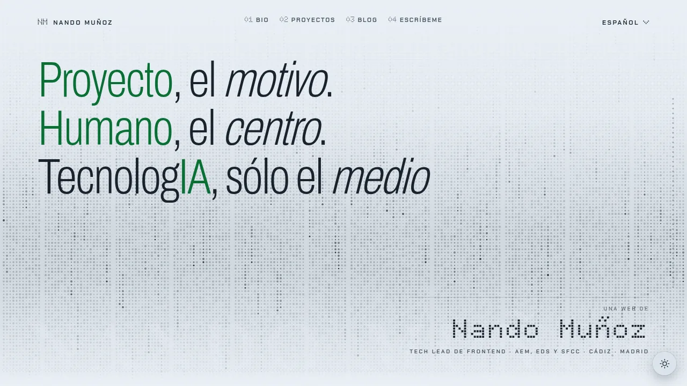

# nandomunoz.com

**Mi web personal: estática, en español, inglés y árabe, sin cookies propias y dibujada con puntos.**

<picture>
  <source media="(prefers-color-scheme: dark)" srcset=".github/assets/readme/cover-dark.webp">
  <source media="(prefers-color-scheme: light)" srcset=".github/assets/readme/cover-light.webp">
  
</picture>

[Qué es](#qué-es) · [Issues](#issues) · [Créditos](#créditos) · [Licencia](#licencia) · [nandomunoz.com](https://nandomunoz.com)

## Qué es

El código de [nandomunoz.com](https://nandomunoz.com): la portada, mis proyectos y mi blog. Está hecho con Astro 7, sin framework de interfaz, y usa [LUZ](https://luzds.com), mi sistema de diseño, con un tema propio, Trama, en el que todo es una rejilla de puntos que se arma al entrar en pantalla (las decisiones están en [astro/DESIGN.md](astro/DESIGN.md)). Se escribe de izquierda a derecha en español e inglés y de derecha a izquierda en árabe, con la misma hoja de estilos.

Prefiero que el despliegue falle a publicar una página rota. Por eso, antes de subir nada, un workflow pasa las pruebas, busca enlaces rotos, comprueba el peso de cada página frente a un presupuesto y abre Chromium para auditar WCAG 2.2 AA con axe.

El repo guarda además mi portafolio anterior, el Cassette, que se genera con `node build.mjs` y tiene una voz que lee cada cinta. Ya no es la web.

## Issues

Los errores y las dudas van a [Issues](https://github.com/nandomunoz/nandomunoz.github.io/issues). Si es un fallo de la web, dime la página, el idioma (es, en o ar) y el navegador. Si es un enlace roto, un texto con una errata o algo que no se puede usar con teclado o lector de pantalla, con la dirección de la página basta.

Discussions está desactivado: no hay otro sitio donde preguntar.

## Créditos

Lo escribo yo. Lo programo yo con ayuda de la IA: ella ayuda, pero no decide.

- [Astro](https://astro.build) y [LUZ](https://luzds.com), mi sistema de diseño (MIT, su licencia está en `assets/vendor/luz/LICENSE`).
- Tipografías con licencia SIL Open Font License 1.1: Archivo, Chakra Petch, Doto y Playfair Display, con sus avisos de copyright en [assets/fonts/OFL.txt](assets/fonts/OFL.txt). Los trazos de los kanjis de los proyectos salen de Noto Sans CJK JP, de Google y Adobe.
- Las voces davefx y joe (CC0) y [Piper](https://github.com/OHF-Voice/piper1-gpl), que las lee, para la voz del Cassette.
- Las letras de comparsa que cito en los análisis son de sus autores, que se nombran en cada artículo.

El resto, con sus autores y las imágenes de cada artículo, en [nandomunoz.com/creditos](https://nandomunoz.com/creditos/).

## Licencia

El código es MIT, en [LICENSE](LICENSE). Los textos y las imágenes que son míos son © Nando Muñoz, con todos los derechos reservados. Quedan fuera de la MIT las letras citadas, las fotos y vídeos de otras personas, las tipografías (SIL OFL) y LUZ (MIT).
